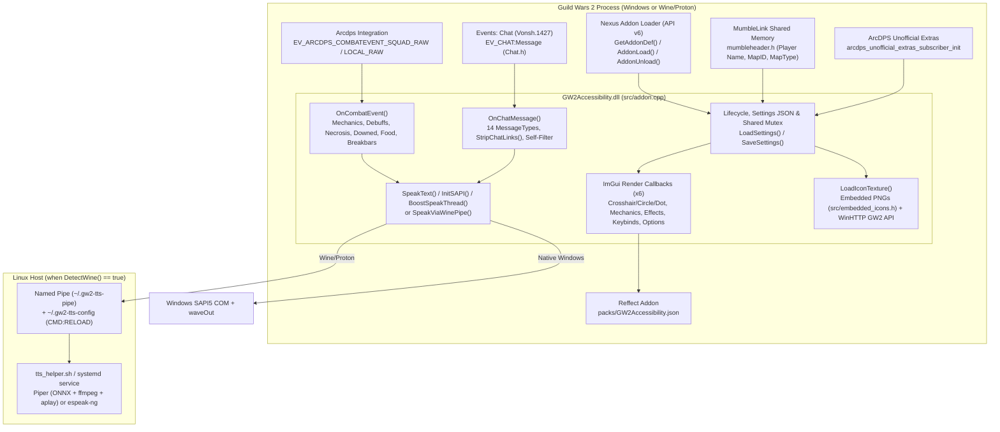

<p align="center">
  <a href="https://ko-fi.com/todd0042">
    
  </a>
</p>

---

# ♿ GW2Accessibility

[](https://github.com/Todd0042/gw2-accessibility/releases)
[](CMakeLists.txt)
[-orange.svg)](TTS_SETUP.md)
[](nexusheader.h)
[](#-8-license--support)
[](https://ko-fi.com/todd0042)

> **A Guild Wars 2 Nexus addon delivering auditory Text-to-Speech callouts, high-visibility cursor highlights, raid mechanic alerts, mouse position snapping, and a live keybind overlay across both Windows and Linux (Wine/Proton).**

---

## 📖 Table of Contents

* **Part 1 — User Overview & Quick Start**
  * [♿ What Is GW2Accessibility?](#-what-is-gw2accessibility)
  * [✨ Key Features at a Glance](#-key-features-at-a-glance)
  * [⚙️ How It Works](#️-how-it-works)
  * [🚀 Quick Start, Installation & Building](#-quick-start-installation--building)
* **Part 2 — Technical Architecture & Reference**
  * [1. System Architecture & Nexus Addon Lifecycle (src/addon.cpp, src/dllmain.cpp)](#1-system-architecture--nexus-addon-lifecycle)
  * [2. Dual-Platform TTS Pipeline: Windows SAPI5 & Linux Pipe Daemon (tts_helper.sh, TTS_SETUP.md)](#2-dual-platform-tts-pipeline-windows-sapi5--linux-pipe-daemon)
  * [3. Combat, Mechanic, Debuff & Chat Event Processing (src/boon_ignore.h, src/buff_names.h, src/tts_messages.h)](#3-combat-mechanic-debuff--chat-event-processing)
  * [4. Visual Overlays, Embedded Icons & Reffect Pack Integration (GW2Accessibility.json, src/embedded_icons.h)](#4-visual-overlays-embedded-icons--reffect-pack-integration)
  * [5. Motor Cursor Snapping & Cognitive Keybind XML Overlay (src/addon.cpp)](#5-motor-cursor-snapping--cognitive-keybind-xml-overlay)
  * [6. Configuration Schema (config.json) & Controls Reference](#6-configuration-schema-configjson--controls-reference)
  * [7. Repository Structure & Build Verification (build.sh, CMakeLists.txt)](#7-repository-structure--build-verification)
  * [8. License & Support](#8-license--support)

---

# Part 1 — User Overview & Quick Start

## ♿ What Is GW2Accessibility?

**GW2Accessibility** (`v1.2.8`) is a native C++17 DLL addon for the [Raidcore Nexus](https://raidcore.gg) Guild Wars 2 addon loader. It is organized around four accessibility pillars—**Motor**, **Auditory**, **Visual**, and **Cognitive**—inside a single ImGui settings panel under **Nexus → Options → GW2Accessibility**.

Whether you play on native **Windows** (using built-in SAPI5 speech synthesis) or **Linux via Wine / Proton / Lutris / Steam** (automatically bridging speech over a named pipe to **Piper** neural voices or **espeak-ng**), every feature runs locally with zero telemetry and persists automatically to `config.json`.

---

## ✨ Key Features at a Glance

### 🦾 Motor
* **2-Slot Mouse Position Memory (`GW2ACCESSIBILITY_MOUSE_TOGGLE`)**: Bind a key in Nexus to snap your cursor between **Position A** and **Position B** (each configured with a 9-point screen anchor and `X%`/`Y%` offsets). Supports **Toggle Mode**, **Hold Mode** (jump to B while held, return to A on release), **Auto-Return** (`Auto-Return` snaps back to A if you moved the mouse manually), and one-click **Swap A <-> B**.

### 🔊 Auditory (Text-to-Speech & Audio Alerts)
* **Chat TTS (13 Channel Toggles)**: Speaks incoming messages from **Party**, **Squad**, **Whisper**, **Squad Broadcast** (including `SquadMessage`), **Map**, **Local Say**, **Guild**, **Guild MotD**, **Error**, **Team PvP**, **Team WvW**, **Emote**, and **Emote Custom** via the **Events: Chat** addon, while stripping `[&...]` chat links and filtering out your own messages using MumbleLink identity.
* **Raid Mechanic Alerts**: Speaks built-in encounter callouts (e.g., *"Corruption, get to fountain"*, *"SAK, go to wall and drop"*, *"Bomb, run away"*, *"Bees. Get away"*) plus custom user-defined `(Skill ID, Name)` mechanics from ArcDPS combat events.
* **Read All Debuffs Mode**: Announces conditions and debuffs applied to your character while filtering out boons using a condition whitelist, ~100+ built-in effect names, and GW2 API `/v2/skills` fallback—and automatically silences combat debuff TTS on **WvW maps** (`IsWvwMap()`).
* **Necrosis Stack Callouts**: Tracks Necrosis (`47414`) stacks on a 5-second cadence, announcing `"Necrosis"`, `"Necrosis at 4 stacks"`, and `"Necrosis removed"`.
* **Ally Downed Alerts**: Speaks `"<PlayerName> downed"`—or plays a synthesized C6+E6 chime (`Play ding sound instead of name`)—when an ally goes down, with an optional **Squad Only** filter.
* **Food & Utility Expiry Alerts**: Detects `Malnourished` (`46587`) and `Diminished` (`46668`) debuffs on map load and during gameplay to speak `"Malnourished"` or `"Diminished"`.
* **Ready Check & Breakbar Alerts**: Speaks `"Ready Check Initiated."` via **ArcDPS Unofficial Extras** when the squad leader starts a ready check, and speaks `"Breakbar active"` / `"Breakbar broken"` on `CBTS_BREAKBARSTATE` events.
* **Windows SAPI5 + Boost & Linux Piper/espeak-ng**: Select Windows SAPI voice, `waveOut` output device, speed (`-10` to `10`), and volume (`0–300%`, with PCM soft-clipped gain boost above `100%`), or use the Linux Wine/Proton pipe daemon (`tts_helper.sh`) with **Apply & Reload** live updates.

### 👁️ Visual
* **Screen Crosshair**: Customizable horizontal and vertical tracking lines across the full screen or a bounded length (`10–1000 px`), adjustable thickness (`1–10 px`), RGBA color picker, and optional *"Only show when cursor is hidden"* mode (useful during action-camera or mouse-drag camera rotation).
* **Cursor Circle & Center Dot**: Optional anti-aliased ring (`5–300 px` radius, configurable outline thickness, RGBA outline, and optional RGBA fill) plus a high-contrast center dot (`1–10 px` radius) around the cursor.
* **Active Mechanic Icons & Reffect Pack**: Displays cached PNG icons for active raid mechanics (`icons/*.png` embedded directly in the DLL, with GW2 API/Wiki fallback), and includes a one-click **"Deploy Accessibility Pack to Reffect"** button that installs [GW2Accessibility.json](GW2Accessibility.json) (`Boons`, `Condis`, `Critical Condis`, `Raid Debuff`, `ScreenOverlays` with `LowHealthFlash` & `ColorBlindFilter`, and `Consumables`) for [Reffect](https://github.com/Zerthox/gw2-reffect).

### 🧠 Cognitive
* **In-Game Keybind Overlay**: Automatically locates and parses your exported Guild Wars 2 `InputBinds/*.xml` file (across native Windows `Documents`, OneDrive-redirected `FOLDERID_Documents`, and Wine/Proton prefixes) and renders a clean overlay pinned to any of 9 screen anchors with adjustable opacity (`0.10–1.00`) and visibility (`Always`, `In Combat Only`, `Out of Combat Only`).
* **12 Toggleable Keybind Categories & Keybind Viewer**: Independently show or hide **Movement**, **Skills**, **Targeting**, **Mounts**, **Squad**, **Camera**, **Screenshot**, **Map**, **UI**, **Build Templates**, **Equipment Templates**, and **Fashion Templates**, browse all parsed bindings with category filters, or export a formatted `keybinds_dump.txt` table.

---

## ⚙️ How It Works

1. **Install into Nexus**: Drop `GW2Accessibility.dll` into your Guild Wars 2 Nexus addons folder (`<GW2>\addons\GW2Accessibility\GW2Accessibility.dll` or `%LOCALAPPDATA%\Nexus\addons\GW2Accessibility\`).
2. **Optional Ecosystem Addons**:
   * **Arcdps Integration** *(bundled with Nexus)* — feeds combat, buff, downed, breakbar, and consumable events.
   * **[Events: Chat](https://github.com/jsantorek/GW2-Chat)** *(by Vonsh.1427, via Nexus library)* — feeds `EV_CHAT:Message` events for Chat TTS.
   * **[ArcDPS Unofficial Extras](https://github.com/Krappa322/arcdps_unofficial_extras_releases)** — feeds squad ready-check transitions.
   * **[Reffect](https://github.com/Zerthox/gw2-reffect)** — loads the deployable `GW2Accessibility.json` boon/condition/overlay pack.
3. **Linux / Wine / Proton Audio**: On startup, `DetectWine()` detects Wine/Proton automatically and switches TTS output to `~/.gw2-tts-pipe` (`Z:<HOME>\.gw2-tts-pipe`), where [tts_helper.sh](tts_helper.sh) speaks lines natively through PipeWire/PulseAudio using **Piper** or **espeak-ng**.
4. **Export Keybinds**: In Guild Wars 2, open **Options → Controls → Export** so your XML binds appear in `Documents\Guild Wars 2\InputBinds\` for the Keybind Overlay.

---

## 🚀 Quick Start, Installation & Building

### Prerequisites

| Component | Required For | Link / Notes |
| :--- | :--- | :--- |
| **Raidcore Nexus** | Loading `GW2Accessibility.dll` | [raidcore.gg](https://raidcore.gg) (API v6) |
| **Arcdps Integration** | Raid mechanics, Debuffs, Ally Downed, Food/Utility, Breakbars | Bundled with Nexus |
| **Events: Chat** (`Vonsh.1427`) | Chat TTS across all 13 channel toggles | Nexus Library / [GW2-Chat](https://github.com/jsantorek/GW2-Chat) |
| **ArcDPS Unofficial Extras** | Ready Check TTS (`"Ready Check Initiated."`) | [arcdps_unofficial_extras_releases](https://github.com/Krappa322/arcdps_unofficial_extras_releases) |
| **Reffect** | Optional visual boon/condi/screen-overlay pack | [Zerthox/gw2-reffect](https://github.com/Zerthox/gw2-reffect) |

### Installation (Windows)

1. Download or build `GW2Accessibility.dll`.
2. Copy `GW2Accessibility.dll` to your Nexus addons folder:
   * `<Guild Wars 2>\addons\GW2Accessibility.dll` (or `%LOCALAPPDATA%\Nexus\addons\GW2Accessibility\GW2Accessibility.dll`).
3. Launch Guild Wars 2, open the **Nexus** menu (`Insert` by default), go to **Options → GW2Accessibility**, and enable the features you want.
4. *(Optional)* Bind **GW2ACCESSIBILITY_MOUSE_TOGGLE** under **Nexus → Settings → Keybinds → GW2Accessibility**.

### Installation (Linux / Wine / Proton)

1. Copy `GW2Accessibility.dll` into the `addons` folder inside your Guild Wars 2 Wine/Proton prefix.
2. Start the Linux TTS daemon before launching Guild Wars 2 (see [TTS_SETUP.md](TTS_SETUP.md) for Piper voice installation, Lutris prelaunch, and Steam launch options):
   ```bash
   chmod +x tts_helper.sh
   ./tts_helper.sh
   ```
3. *(Recommended)* Install and enable the included systemd user unit ([systemd/gw2-tts-helper.service](systemd/gw2-tts-helper.service)):
   ```bash
   cp systemd/gw2-tts-helper.service ~/.config/systemd/user/gw2-tts-helper.service
   systemctl --user daemon-reload
   systemctl --user enable --now gw2-tts-helper.service
   ```
4. Export your keybinds in-game (**Options → Controls → Export**) so the Keybind Overlay detects your XML file automatically.

### Building from Source

#### Cross-Compiling on Linux (MinGW-w64)
Requires `cmake` (`3.20+`) and `x86_64-w64-mingw32-g++`:
```bash
./build.sh
# Clean rebuild:
./build.sh --clean
```
Or run CMake directly using [toolchain-mingw.cmake](toolchain-mingw.cmake):
```bash
cmake -B build -DCMAKE_TOOLCHAIN_FILE=toolchain-mingw.cmake -DCMAKE_BUILD_TYPE=Release
cmake --build build --config Release -- -j"$(nproc)"
# Output: build/GW2Accessibility.dll
```

#### Native Build on Windows (Visual Studio 2022 / MSVC)
See [windows-instructions.txt](windows-instructions.txt):
```powershell
cmake -B build -DCMAKE_BUILD_TYPE=Release
cmake --build build --config Release
# Output: build\Release\GW2Accessibility.dll
```

---
---

# Part 2 — Technical Architecture & Reference

> *Every file path, symbol, constant, skill ID, and configuration field below is verified directly against `GW2Accessibility` `v1.2.8`.*

---

## 1. System Architecture & Nexus Addon Lifecycle

**GW2Accessibility** compiles into a single self-contained Windows x86_64 shared library (`GW2Accessibility.dll`) statically linked against `libgcc`, `libstdc++`, and `winpthread`, bundling Dear ImGui `1.80` (`third_party/imgui/`) and `nlohmann/json` `3.11.3` (`third_party/nlohmann/json.hpp`).



### Entry Points & Nexus Registration ([src/addon.cpp](src/addon.cpp), [src/addon.h](src/addon.h), [src/dllmain.cpp](src/dllmain.cpp))
* **`GetAddonDef()`**: Exports `AddonDefinition_t` with Signature `897849539` (`0x358418C3`), `APIVersion = NEXUS_API_VERSION` (`6`), `Version = { 1, 2, 8, 0 }`, `Flags = AF_None`, `Provider = UP_GitHub`, and `UpdateLink = "https://github.com/Todd0042/gw2-accessibility"`.
* **`AddonLoad(AddonAPI_t* aAPI)`**:
  1. Runs `DetectWine()` to determine native Windows vs. Wine/Proton execution.
  2. Calls `LoadSettings()` to read `<addon_dir>/GW2Accessibility/config.json`, migrate legacy mechanic IDs, scan keybind XMLs, and preload configured icons.
  3. Calls `EnumerateTtsVoices()` and `EnumerateTtsOutputDevices()`.
  4. Calls `InitMumble()` to map `L"MumbleLink"` (`Mumble::Data`) for `g_PlayerName` and `Context.MapType` / `Context.MapID`.
  5. Registers the `GW2ACCESSIBILITY_MOUSE_TOGGLE` keybind (`OnMouseToggleKeybind`).
  6. Registers **6 ImGui render callbacks**:
     * `RT_Render`: `OnRender`, `OnMechanicsWindowRender`, `OnEffectManagerRender`, `OnKeybindOverlayRender`, `OnKeybindConfigRender`
     * `RT_OptionsRender`: `OnOptionsRender`
  7. Subscribes to `EV_CHAT:Message` (`GW2_CHAT_EVENT`), `EV_ARCDPS_COMBATEVENT_SQUAD_RAW`, and `EV_ARCDPS_COMBATEVENT_LOCAL_RAW`.
* **`AddonUnload()`**: Saves settings, deregisters the keybind, all 6 GUI callbacks, and all 3 event subscriptions, releases `g_pVoice`, and unmaps/closes the `MumbleLink` handle.
* **`arcdps_unofficial_extras_subscriber_init()`**: Exported C callback (API v2, subscriber info v1) that registers `OnSquadUpdate` with ArcDPS Unofficial Extras.

---

## 2. Dual-Platform TTS Pipeline: Windows SAPI5 & Linux Pipe Daemon

### Windows SAPI5 & PCM Boost Engine ([src/addon.cpp](src/addon.cpp))
* **Voice Enumeration (`EnumerateTtsVoices()`)**: Scans `HKLM\SOFTWARE\Microsoft\Speech_OneCore\Voices\Tokens` and `HKLM\SOFTWARE\Microsoft\Speech\Voices\Tokens`, prepending `"System Default"`.
* **Audio Output Enumeration (`EnumerateTtsOutputDevices()`)**: Queries `waveOutGetNumDevs()` and `waveOutGetDevCapsW()` to list wave output device indices (`"0"`, `"1"`, …), prepending `"Default (System)"`.
* **Initialization (`InitSAPI()`)**: Initializes COM (`COINIT_MULTITHREADED` with `COINIT_APARTMENTTHREADED` fallback), instantiates `CLSID_SpVoice`, binds the selected voice via `ISpObjectToken::SetId(nullptr, fullRegistryPath, FALSE)`, binds the audio device via `ISpMMSysAudio::SetDeviceId(waveIdx)` + `SetOutput()`, and applies rate (`-10` to `10`) and volume (`0–100`).
* **Volume > 100% Soft-Clipped PCM Boost (`BoostSpeakThread()`)**: When `g_TtsVolume > 100` (up to `300%`) on native Windows, speech is rendered into an in-memory `IStream` via `ISpStream` (`22050 Hz`, 16-bit mono PCM), scaled by `gain = g_TtsVolume / 100.0f` through a `std::tanh(s)` soft limiter to prevent harsh digital clipping, and played asynchronously to the chosen `waveOut` device (`CALLBACK_EVENT`).

### Linux / Wine / Proton Named-Pipe Bridge ([tts_helper.sh](tts_helper.sh), [TTS_SETUP.md](TTS_SETUP.md), [systemd/gw2-tts-helper.service](systemd/gw2-tts-helper.service))
* **11-Point Wine Detection (`DetectWine()`)**: Checks `ntdll.dll` exports (`wine_get_version`, `wine_get_build_id`, `wine_get_host_version`), loaded Wine drivers (`winex11.drv`, `winewayland.drv`, `winebus.sys`, `winemac.drv`), environment variables (`WINE`, `WINEPREFIX`, `PROTON_VERSION`, `XDG_RUNTIME_DIR`), registry `HKLM\Software\Wine`, `Z:\`, `Z:\proc\version`, and DXGI adapter descriptions (`Wine`, `llvmpipe`, `DXVK`, `softpipe`).
* **Wine Pipe Fallback (`SpeakViaWinePipe()`)**: When SAPI fails under Wine, `g_WineTtsFallback` is enabled. Utterances are sanitized to single lines and written to `Z:<HOME>\.gw2-tts-pipe` (`GetLinuxHome()` resolves `HOME`, `WINEPREFIX`, or `USERNAME`). After 5 consecutive open failures, fallback temporarily pauses until re-triggered.
* **Live Config Reload (`WriteLinuxTtsConfig()`)**: Clicking **Apply & Reload** in the `Auditory` settings writes `~/.gw2-tts-config` (`ENGINE`, `VOICE`, `SPEED`, `PITCH`, `AMPLITUDE`) and sends `CMD:RELOAD\n` over the FIFO.
* **`tts_helper.sh` Daemon**:
  * Opens `~/.gw2-tts-pipe` with `O_RDWR` (`exec 3<>"$PIPE"`) so writer disconnects never trigger spurious EOF races.
  * **Piper mode** *(default)*: Searches `~/piper/piper/piper`, `/usr/bin/piper-tts`, `/opt/piper-tts/piper`, `/usr/bin/piper`, locates `<VOICE>.onnx` in `PIPER_MODEL_PATH`, `~/.local/share/piper-voices`, or `/usr/share/piper-voices`, auto-reads the model's `audio.sample_rate` from `.onnx.json`, maps `SPEED` (`80–500 WPM`) to `--length_scale = 150.0 / SPEED`, applies `ffmpeg` `volume = AMPLITUDE / 100.0`, and outputs to `aplay`. Falls back to `espeak-ng` if the model or binary is missing.
  * **espeak-ng mode**: Invokes `espeak-ng -v "$VOICE" -s "$SPEED" -p "$PITCH" -a "$AMPLITUDE"`.

---

## 3. Combat, Mechanic, Debuff & Chat Event Processing

### Combat Event State Machine (`OnCombatEvent()` in [src/addon.cpp](src/addon.cpp), [arcdpsheader.h](arcdpsheader.h))
Subscribed to `EV_ARCDPS_COMBATEVENT_SQUAD_RAW` and `EV_ARCDPS_COMBATEVENT_LOCAL_RAW`:

| Statechange / Event | Handler Behavior |
| :--- | :--- |
| `ev == nullptr` | Agent tracking event; updates `g_InSquad` from `src->Team > 0` when `dst->IsSelf`. |
| `IsStatechange == 1` (`CBTS_ENTERCOMBAT`) | Sets `g_InCombat = true` (when `src->IsSelf`); resets Keep Construct tracking for Tofu's Toggle. |
| `IsStatechange == 2` (`CBTS_EXITCOMBAT`) | Sets `g_InCombat = false` (when `src->IsSelf`). |
| `IsStatechange == 3` (`CBTS_CHANGEUP`) | Removes `SourceAgent` from `g_DownedAgents`. |
| `IsStatechange == 5` (`CBTS_CHANGEDOWN`) | If `g_AllyDownedEnabled` (and not filtered by `g_AllyDownedSquadOnly && src->IsSelf`), adds `SourceAgent` to `g_DownedAgents` and either plays the synthesized C6 (`1046.5 Hz`) + E6 (`1318.5 Hz`) chime (`PlayDingSound()`) or speaks `"<AgentName> downed"`. |
| `IsStatechange == 10` (`CBTS_REWARD`) | If `g_TofusToggle && g_InKeepConstructFight`, speaks `"Tofu, KC is dead, check your gear."`. |
| `IsStatechange == 22` (`CBTS_TEAMCHANGE`) | Updates `g_InSquad = (DestinationAgent > 0)` when `src->IsSelf`. |
| `IsStatechange == 34` (`CBTS_BREAKBARSTATE`) | If `g_BreakbarAlertsEnabled`, speaks `"Breakbar active"` (`DestinationAgent == 1`) or `"Breakbar broken"` (`DestinationAgent == 3`). |
| `IsStatechange == 69 \|\| 18` (`BUFF_INIT`) | Dumps active buffs on map load (`MapID != 0`), caches names, and if `g_FoodUtilityExpiryEnabled`, immediately speaks `"Malnourished"` (`46587`) or `"Diminished"` (`46668`). |
| `IsStatechange == 0 \|\| 72` (`Buff == 1`) | Tracks active mechanic icons (`g_ActiveMechanics`, 15s timeout), logs discovered non-standard effects (`g_EncounteredEffects`), checks self & WvW map (`IsWvwMap()`), triggers Food/Utility expiry (`46587`/`46668`), handles Necrosis (`47414`), and resolves TTS in priority order: `g_BuiltinTtsMessages` $\rightarrow$ `g_BuiltinMechanics` $\rightarrow$ `g_RaidMechanics` $\rightarrow$ `IsCondition()` (`g_ReadAllDebuffs`). |

### Built-in Raid Mechanics & TTS Callouts ([src/tts_messages.h](src/tts_messages.h), [src/boon_ignore.h](src/boon_ignore.h), [src/buff_names.h](src/buff_names.h))

| Skill / Effect ID | Mechanic Name | Built-in TTS Message *(if custom)* | Embedded Icon |
| :---: | :--- | :--- | :--- |
| `34387` | Volatile Poison | *(uses name)* | [Volatile_Poison.png](icons/Volatile_Poison.png) |
| `38049` | Shared Agony | *(uses name)* | [Shared_Agony.png](icons/Shared_Agony.png) |
| `48042` | Soul Shackle | *(uses name)* | [Soul_Shackle.png](icons/Soul_Shackle.png) |
| `34416` | Corruption | `"Corruption, get to fountain"` | [corruption_matthias.png](icons/corruption_matthias.png) |
| `34450` | Unstable Blood Magic | `"SAK, go to wall and drop"` | [Unstable_Blood_Magic.png](icons/Unstable_Blood_Magic.png) |
| `47646` | Arcing Affliction | `"Bomb, run away"` | [Arcing_Affliction.png](icons/Arcing_Affliction.png) |
| `34508` *(+ 8 variants)* | Fixated | *(uses name)* | [fixated.png](icons/fixated.png) |
| `47414` | Necrosis | `"Necrosis"` / `"Necrosis at 4 stacks"` / `"Necrosis removed"` | [Necrosis.png](icons/Necrosis.png) |
| `79526` | Biting Swarm | `"Bees. Get away"` | [biting_swarm.png](icons/biting_swarm.png) |

* **`NormalizeMechanicID()`**: Collapses all 8 additional Fixated encounter IDs (`47434`, `48533`, `39131`, `39928`, `38985`, `39558`, `58136`, `79380`) onto canonical ID `34508`.
* **Condition Whitelist ([src/boon_ignore.h](src/boon_ignore.h))**: `g_ConditionIds` whitelists 31 verified conditions, control effects, and raid debuffs (including `736` Bleeding, `737` Burning, `861` Confusion, `723` Poisoned, `19426` Torment, `720` Blinded, `722` Chilled, `721` Crippled, `727` Immobilized, `742` Weakness, `738` Vulnerability, `26766` Slow, `791` Fear, `27705` Taunt, `872` Stun, `833` Daze, `890` Revealed, etc.) so boons are never spoken in **Read All Debuffs** mode.
* **Name Resolution (`FetchSkillName()`)**: Checks combat-event `skillname` $\rightarrow$ runtime `g_DebuffNameCache` $\rightarrow$ `g_BuiltinBuffNames` (~100+ entries in [src/buff_names.h](src/buff_names.h)) $\rightarrow$ WinHTTP HTTPS `GET api.guildwars2.com/v2/skills/{id}` fallback.

### Chat TTS Pipeline (`OnChatMessage()` in [src/addon.cpp](src/addon.cpp), [src/Chat.h](src/Chat.h))
* Handles all 14 `MessageType` values (`Party`, `Squad`, `Map`, `Local`, `Whisper`, `SquadBroadcast`, `Guild`, `SquadMessage`, `Error`, `GuildMotD`, `TeamPvP`, `TeamWvW`, `Emote`, `EmoteCustom`).
* Checks `Whisper_IsFromMe` flag and compares `CharacterName` against MumbleLink `g_PlayerName` to suppress self-messages.
* Formats commander messages (`"Party comm ..."`, `"Squad comm ..."`) and strips in-game `[&...]` chat link codes via `StripChatLinks()`.

---

## 4. Visual Overlays, Embedded Icons & Reffect Pack Integration

* **Cursor Highlights (`OnRender()` in [src/addon.cpp](src/addon.cpp))**:
  * **Crosshair**: Draws `ImGui::GetOverlayDrawList()` lines centered on `ImGui::GetMousePos()`, optionally hidden while the OS cursor is visible (`GetCursorInfo(&ci)` checking `CURSOR_SHOWING`).
  * **Cursor Circle**: Temporarily enables `ImDrawListFlags_AntiAliasedLines | ImDrawListFlags_AntiAliasedFill` and disables `ImDrawListFlags_AntiAliasedLinesUseTex` for backend-independent geometric anti-aliasing, drawing optional fill + outline ring.
  * **Cursor Dot**: Draws a solid `AddCircleFilled` dot at the cursor center.
* **Mechanic Icon Cache & Staggered Pre-Fetch (`LoadIconTexture()`)**:
  * On load (`30s` delay, then `1` icon every `5s`), pre-fetches built-in mechanic icons.
  * Checks Nexus `Textures_Get("gw2accessibility_icon_<id>")` $\rightarrow$ on-disk `<addon_dir>\icons\<id>.png` $\rightarrow$ embedded PNG byte arrays in [src/embedded_icons.h](src/embedded_icons.h) $\rightarrow$ GW2 API `/v2/skills/{id}` icon URL or Wiki URL via `DownloadUrlToFile()` $\rightarrow$ async `Textures_LoadFromFile()`.
* **Reffect Accessibility Pack ([GW2Accessibility.json](GW2Accessibility.json), [src/reffect_pack.h](src/reffect_pack.h))**:
  * `packVersion: 2` defines 6 top-level Reffect groups: **`Boons`** (`Quickness`, `Alacrity`, `Might`, `Fury`, `Aegis`, `Stability`), **`Condis`** (`Bleeding`, `Burning`, `Poisoned`, `Torment`, `Confusion`, `Chilled`, `Crippled`, `Slow`, `Weakness`, `Vulnerability`), **`Critical Condis`** (`Fear`, `Immobilized`), **`Raid Debuff`**, **`ScreenOverlays`** (`LowHealthFlash`, `ColorBlindFilter`), and **`Consumables`** (`Food`, `Utility`).
  * Deployed on demand via **Deploy Accessibility Pack to Reffect** (`DeployReffectPack()`), writing to `<reffect_addon_dir>\packs\GW2Accessibility.json`.

---

## 5. Motor Cursor Snapping & Cognitive Keybind XML Overlay

### Mouse Position Snapping (`GetTargetPosition()`, `OnMouseToggleKeybind()`)
* Computes screen coordinates from `GetSystemMetrics(SM_CXSCREEN / SM_CYSCREEN)`, 9 `AnchorPoint` grid anchors (`TopLeft` through `BottomRight`), and percentage offsets (`offsetXPct`, `offsetYPct` in `[-50.0, +50.0]`), clamped to screen bounds, then calls `SetCursorPos(x, y)`.
* Records `(g_LastMoveX, g_LastMoveY)` so `g_SnapToAOnUserMove` detects manual cursor movement and resets to Position A on the next press.

### Keybind XML Parser & Overlay (`ScanKeybindFiles()`, `ParseKeybindXml()`, `OnKeybindOverlayRender()`)
* **Cross-Platform Path Discovery (`ScanKeybindFiles()`)**:
  * **Wine/Proton**: Resolves `C:\users\steamuser\Documents\Guild Wars 2\InputBinds\` via `WinePathToUnix()` (inspecting `dosdevices` symlinks and `/pfx/` paths) and `$HOME/Documents/Guild Wars 2/InputBinds/`.
  * **Native Windows**: Queries `SHGetKnownFolderPath(FOLDERID_Documents, ...)` (supporting OneDrive-redirected Documents folders) before falling back to `g_API->Paths_GetCommonDirectory()`.
* **GW2 Button Code Decoder (`Gw2ButtonToKeyName()`, `FormatBind()`)**: Decodes GW2's proprietary XML button numbers (mouse `1`/`2`, special keys `3–27`, `F1–F12` at `32–43` and `96–104`, `Num+` at `91`, ASCII `44–90` / `92–95` / `105–126`) and modifier bitmasks (`1` = Shift, `2` = Ctrl, `4` = Alt).
* **Category Grouping (`CategorizeAction()`)**: Maps actions into 12 overlay sections (`Movement`, `Skills`, `Targeting`, `Mounts`, `Squad`, `Camera`, `Screenshot`, `Map`, `UI`, `Build Templates`, `Equipment Templates`, `Fashion Templates`) plus `General` in the Keybind Viewer, with a `Dump to File` button writing `keybinds_dump.txt` to the addon directory.

---

## 6. Configuration Schema (`config.json`) & Controls Reference

Settings persist automatically in `<Nexus>/addons/GW2Accessibility/config.json` via `SaveSettings()` and `LoadSettings()`.

### Top-Level & Visual / Motor / Cognitive Keys

| JSON Key | Default | Description |
| :--- | :--- | :--- |
| `enabled` | `true` | Master enable for `GW2ACCESSIBILITY_MOUSE_TOGGLE`. |
| `positions` | `[{BottomCenter, 0, -2}, {Center, 0, 10.1}]` | Array of 2 `{anchor (0–8), offsetXPct, offsetYPct}` cursor snap targets. |
| `holdMode` | `false` | `true` = hold keybind for Position B, release for A; `false` = toggle. |
| `snapToAOnUserMove` | `true` | Snaps back to Position A if the mouse moved since the last snap. |
| `crosshairEnabled` / `crosshairFullScreen` / `crosshairLength` / `crosshairThickness` / `crosshairColor` / `crosshairOnlyWhenHidden` | `false` / `true` / `150.0` / `2.0` / `[1,0,0,1]` / `true` | Crosshair overlay appearance and hidden-cursor gating. |
| `cursorCircleEnabled` / `cursorCircleRadius` / `cursorCircleThickness` / `cursorCircleColor` / `cursorCircleFillEnabled` / `cursorCircleFillColor` | `false` / `40.0` / `2.0` / `[1,0,0,1]` / `false` / `[1,0,0,0.25]` | Anti-aliased circle ring and optional fill around cursor. |
| `cursorDotEnabled` / `cursorDotRadius` / `cursorDotColor` | `false` / `2.0` / `[1,0,0,1]` | Solid center dot at cursor coordinates. |
| `iconDisplayEnabled` / `iconSize` / `iconSpacing` / `iconOpacity` / `iconAnchor` / `iconOffsetX` / `iconOffsetY` | `false` / `32.0` / `4.0` / `1.0` / `Center` / `0.0` / `-10.0` | Active mechanic icon strip layout. |
| `keybindOverlayEnabled` / `keybindVisibility` / `keybindPositionAnchor` / `keybindPositionX` / `keybindPositionY` / `keybindOpacity` | `false` / `0` (`Always`) / `MiddleLeft` / `0.0` / `0.0` / `0.4` | Keybind overlay visibility (`0`=Always, `1`=In Combat, `2`=Out of Combat) and layout. |
| `keybindShowMovement`, `keybindShowSkills`, `keybindShowMounts` | `true` | Default-enabled keybind overlay sections. |
| `keybindShowTargeting`, `keybindShowSquad`, `keybindShowCamera`, `keybindShowScreenshot`, `keybindShowMap`, `keybindShowUI`, `keybindShowBuildTemplates`, `keybindShowEquipmentTemplates`, `keybindShowFashionTemplates` | `false` | Additional toggleable keybind overlay sections. |
| `keybindFile` / `keybindFileIndex` / `manualKeybindPath` | `""` / `-1` / `""` | Selected GW2 `InputBinds` XML filename/path. |

### Auditory, Combat & TTS Keys (`config.json`)

| JSON Key | Default | Description |
| :--- | :--- | :--- |
| `tts.enabled` | `false` | Master toggle for Chat TTS. |
| `tts.party` / `tts.squad` / `tts.whisper` / `tts.squadBroadcast` | `true` | Default-enabled chat TTS channels. |
| `tts.map` / `tts.local` / `tts.guild` / `tts.guildMotD` / `tts.error` / `tts.teamPvP` / `tts.teamWvW` / `tts.emote` / `tts.emoteCustom` | `false` | Optional chat TTS channels. |
| `tts.voiceTokenId` / `tts.outputTokenId` | `""` | Windows SAPI registry token ID and `waveOut` device index. |
| `tts.volume` / `tts.rate` | `100` / `0` | Windows SAPI volume (`0–300`, `>100` uses PCM boost) and rate (`-10` to `10`). |
| `tts.linuxEngine` / `tts.linuxVoice` / `tts.linuxSpeed` / `tts.linuxPitch` / `tts.linuxAmplitude` | `"piper"` / `"en_US-ryan-high"` / `150` / `40` / `175` | Linux daemon settings written to `~/.gw2-tts-config` on **Apply & Reload**. |
| `mechanicsAnnounce` / `readAllDebuffs` | `false` / `false` | Custom raid mechanic announcements and Read All Debuffs mode. |
| `builtinMechanicTts` / `builtinMechanicIcon` | `{}` | Per-ID boolean maps for the 9 built-in mechanics. |
| `raidMechanics` | `[]` | Array of `{skillID, name, ttsEnabled, iconEnabled}` custom mechanics. |
| `foodUtilityExpiry` / `readyCheckTts` / `breakbarAlerts` | `false` | Consumable expiry (`46587`/`46668`), Unofficial Extras ready check, and breakbar TTS. |
| `allyDownedEnabled` / `allyDownedSquadOnly` / `allyDownedDingSound` | `false` | Ally downed callouts, squad-only filter, and synthesized chime toggle. |
| `tofusToggle` | `false` | Keep Construct kill reminder (`"Tofu, KC is dead, check your gear."`). |

---

## 7. Repository Structure & Build Verification

```text
gw2-accessibility/
├── CMakeLists.txt                   # CMake 3.20+ C++17 shared DLL build (GW2Accessibility v1.2.8)
├── toolchain-mingw.cmake            # x86_64-w64-mingw32 cross-compilation toolchain
├── build.sh                         # Automated Linux MinGW build + export/DLL dependency check
├── GW2Accessibility.json            # Source-of-truth Reffect pack (packVersion: 2, 6 element groups)
├── tts_helper.sh                    # Linux native FIFO daemon (~/.gw2-tts-pipe -> Piper / espeak-ng)
├── systemd/
│   └── gw2-tts-helper.service       # Systemd user unit for auto-starting tts_helper.sh
├── TTS_SETUP.md                     # Detailed Linux/Wine Piper & espeak-ng setup guide
├── windows-instructions.txt         # Native Visual Studio 2022 / CMake build & deploy notes
├── Nexus.h / nexusheader.h          # Nexus Addon API v6 definitions
├── arcdpsheader.h                   # ArcDPS CombatEvent, AgentShort & ECombatStateChange structs
├── mumbleheader.h                   # Guild Wars 2 MumbleLink shared memory structs & map enums
├── icons/                           # Source PNG icons for the 9 built-in raid mechanics
├── src/
│   ├── dllmain.cpp                  # Windows DLL entry point
│   ├── addon.h                      # AddonLoad / AddonUnload declarations
│   ├── addon.cpp                    # Core addon, TTS engines, combat/chat handlers, overlays & UI
│   ├── Chat.h                       # Events: Chat (EV_CHAT:Message) ABI structs
│   ├── unofficial_extras.h          # ArcDPS Unofficial Extras squad/ready-check structs
│   ├── boon_ignore.h                # Condition ID whitelist (g_ConditionIds) & legacy boon set
│   ├── buff_names.h                 # ~100+ built-in buff/condition/mechanic ID-to-name mappings
│   ├── tts_messages.h               # Action-oriented built-in TTS messages (g_BuiltinTtsMessages)
│   ├── embedded_icons.h             # Compiled PNG byte arrays for the 9 built-in mechanic icons
│   └── reffect_pack.h               # Embedded Reffect pack JSON string (g_ReffectPackJson)
└── third_party/
    ├── imgui/                       # Dear ImGui 1.80
    └── nlohmann/json.hpp            # nlohmann/json 3.11.3
```

### Build & Export Verification ([build.sh](build.sh))
Running `./build.sh` compiles `build/GW2Accessibility.dll` and verifies via `x86_64-w64-mingw32-objdump`:
1. Export table (`objdump -x`) contains the expected Nexus and Unofficial Extras entry points (`GetAddonDef`, `arcdps_unofficial_extras_subscriber_init`).
2. Import table (`objdump -p`) links only standard Windows system DLLs (static `libgcc`, `libstdc++`, and `winpthread` ensure zero stray MinGW runtime DLL dependencies).

---

## 8. License & Support

* **License**: Stated in the repository's prior documentation as **GPL-3.0** *(note: there is currently no standalone `LICENSE` file in the repository root; third-party libraries in `third_party/imgui/` and `third_party/nlohmann/json.hpp` retain their respective licenses)*.
* **Author**: [Todd0042](https://github.com/Todd0042)

<p align="center">
  If GW2Accessibility helps make Tyria more accessible for you or your static, consider supporting development:<br/><br/>
  <a href="https://ko-fi.com/todd0042" target="_blank">
    
  </a>
</p>

---

<p align="center">
  <a href="https://ko-fi.com/todd0042">
    
  </a>
</p>
